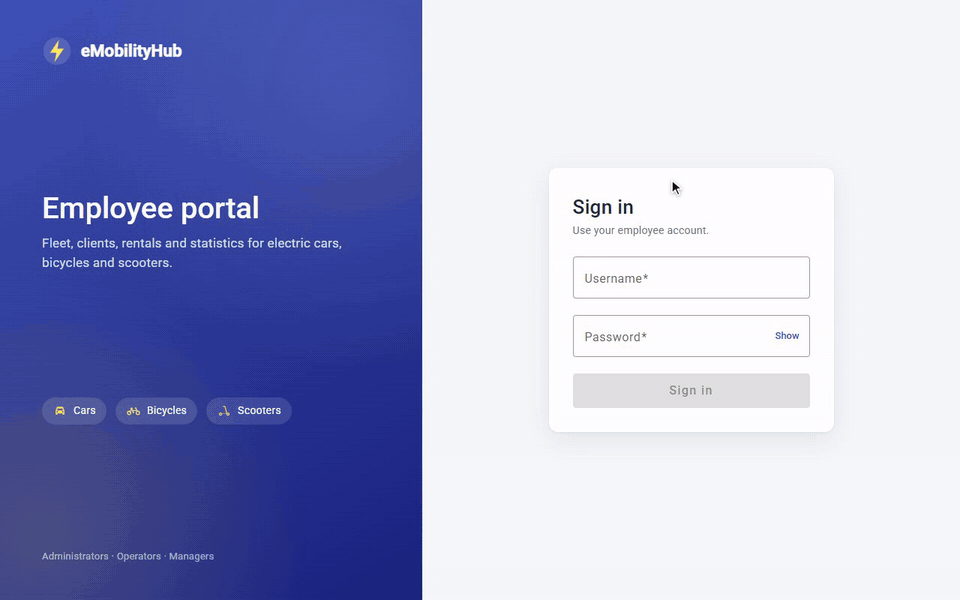
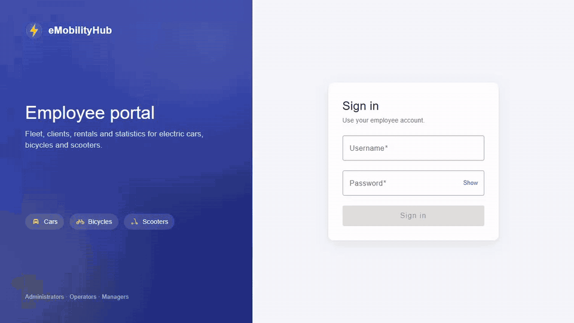
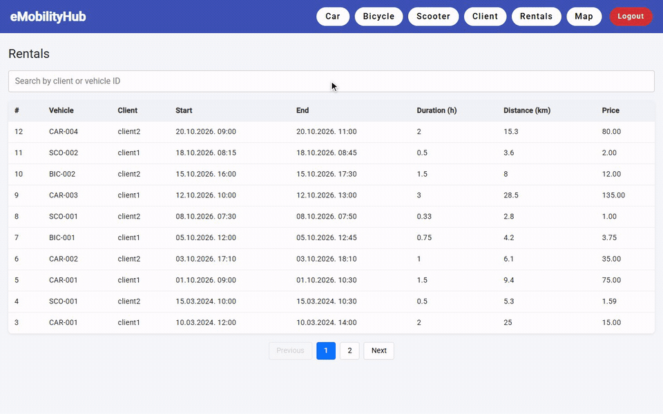
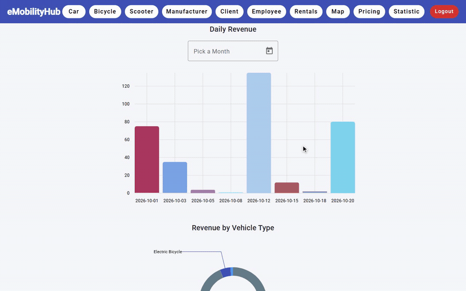
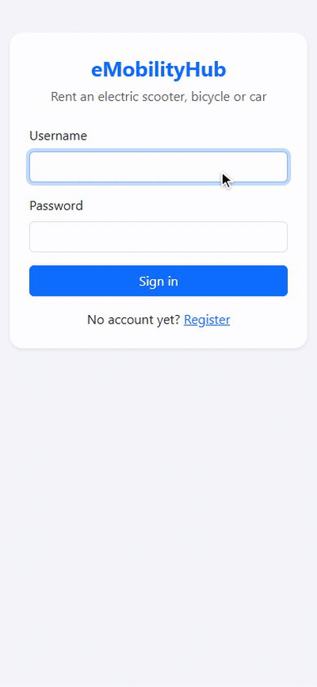
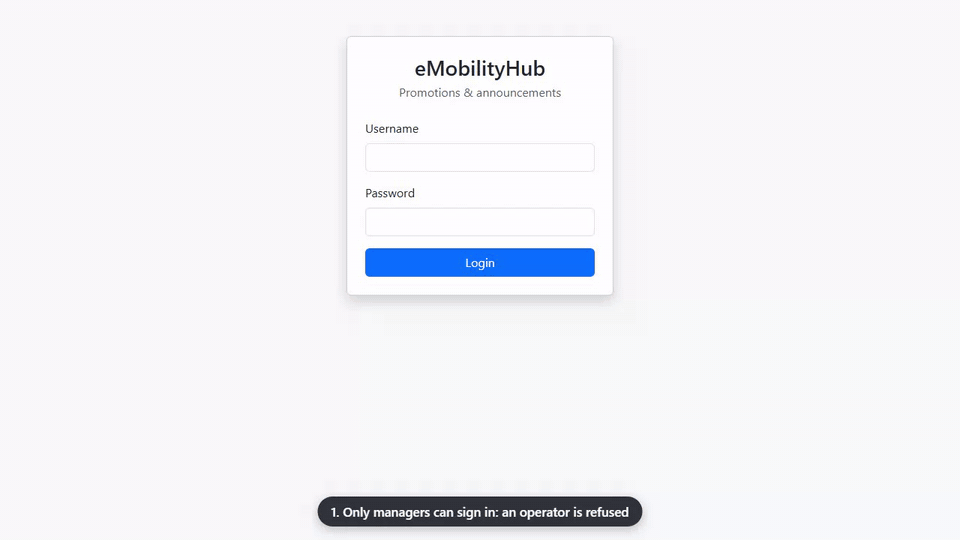
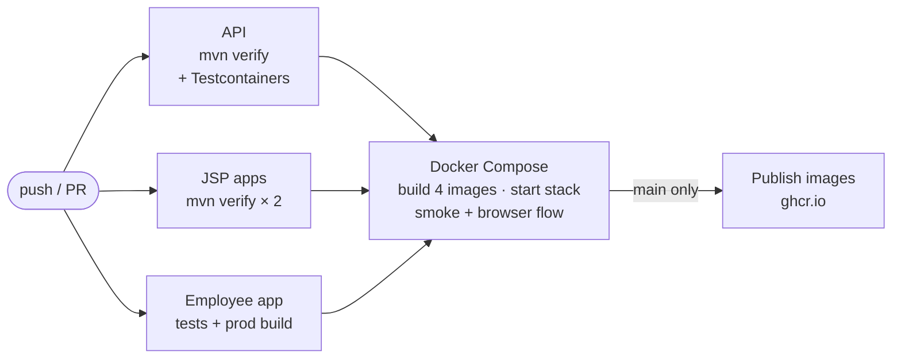
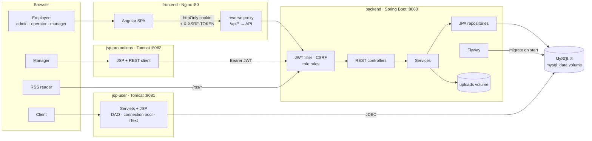
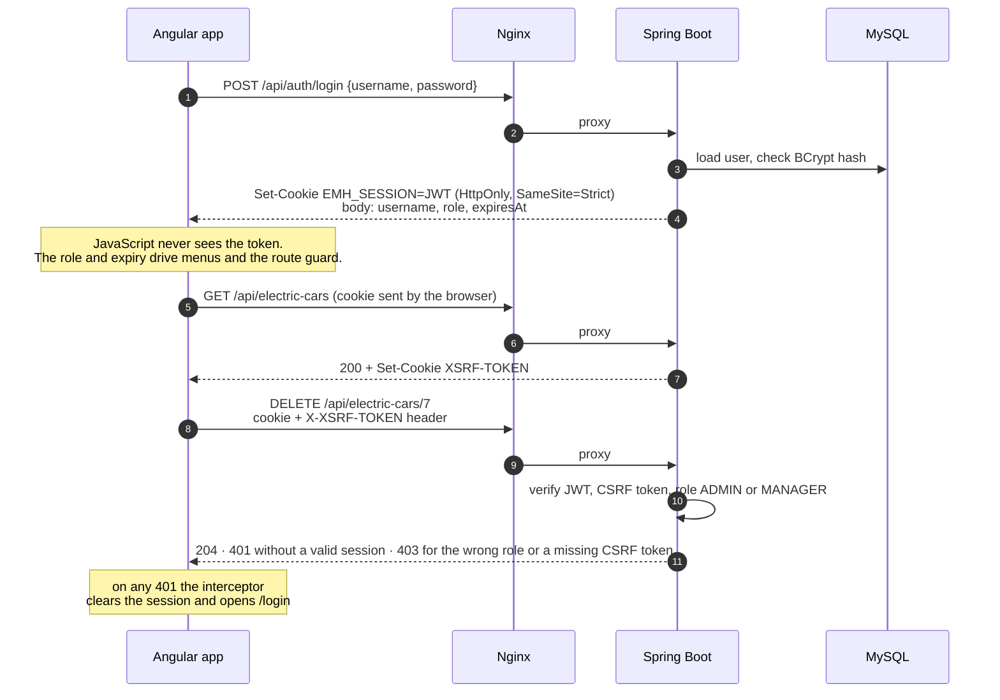
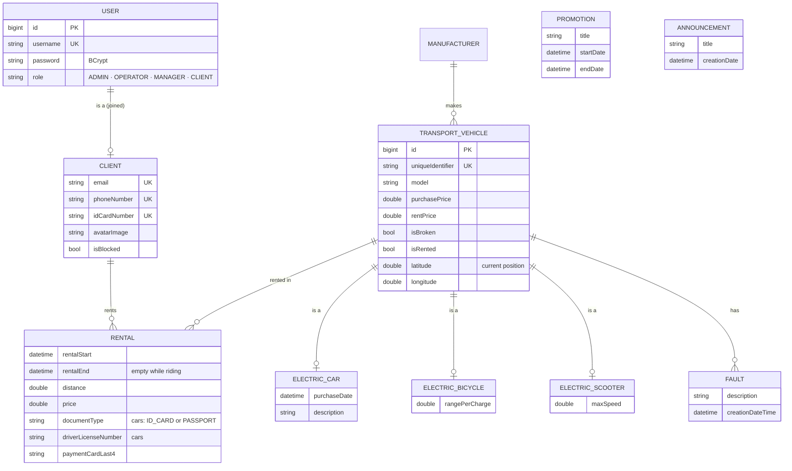

<div align="center">

# 🚗🛵🚴 eMobilityHub

[](https://github.com/pero-grubac/e-Mobility-Hub/actions/workflows/ci.yml)


**A rental platform for electric cars, bicycles and scooters: an employee back office, a client web shop and a promotions portal on one Spring Boot API.**



</div>

---

## 📌 Project Overview

**eMobilityHub** is a web platform for a fictional company that rents electric vehicles. Employees manage the fleet, manufacturers, clients, faults and prices; clients rent vehicles and download invoices; managers run promotions and announcements that are also published as RSS feeds.

The system is four applications on one MySQL database:

| Application | Stack | Who uses it | What it does |
|-------------|-------|-------------|--------------|
| 🏢 **Employee app** | Angular 17 + Angular Material | Admins, operators, managers | Fleet, manufacturers, clients, employees, faults, rentals, statistics, CSV import |
| 🛒 **Client app** | JSP / Servlets (Model 2), Maven, mobile-first | Clients | Registration, ride flow (location, payment, live ride, finish), fault reports, rental history, PDF invoices, profile |
| 🎯 **Promotions app** | JSP + REST client, Maven | Managers | Promotions and announcements (CRUD, search) |
| ⚙️ **API** | Spring Boot 3.4, Spring Security, Flyway | The Angular and promotions apps | REST API, authentication, file uploads, statistics, RSS |

The client app talks to MySQL directly over JDBC; the assignment does not allow it to use the REST API.

---

## 🎬 Applications

Each recording shows the main flow of one role; the caption at the bottom names the step.

### 🏢 Employee app · 🔑 Administrator



Fleet tables with every field and status → add a car → import scooters from CSV (one row rejected with its reason) → edit a car on its detail page → add a fault and delete an old one, see the vehicle's rentals → create a manufacturer → block and unblock a client → create an employee.

### 🏢 Employee app · 🔧 Operator



Search the rentals and open one (read only) → the fleet on a map, filtered by status → open a vehicle from the map → report a fault, then mark it fixed after the repair → block and unblock a client.

### 🏢 Employee app · 📊 Manager



Revenue per day for a chosen month → revenue by vehicle type and faults per vehicle → set rental prices for the fleet → the admin pages (cars, employees) and operator pages (rentals, map) that managers also have.

### 🛒 Client app (mobile-first)



Register with a profile picture → sign in → the four options → pick a car → detect the start location → ID document and driver's licence → card payment and confirmation → live ride clock and price → finish at the drop-off point → PDF invoice → report a broken scooter → profile with all rentals → change the password.

### 🎯 Promotions app (managers only)



An operator is refused → the manager signs in → promotions and announcements on one page, one search for both → create a promotion with its dates → open and edit it → publish an announcement.

---

## ✨ Features

- 🚘 **Fleet management**: cars, bicycles and scooters in tables with every field and a live status (available, rented, broken); create, delete, CSV import
- 🔍 **Vehicle detail** with the manufacturer, all faults (add, edit, delete, search) and all rentals of that vehicle
- 🗺️ **Fleet map** for operators: every vehicle at its current position on OpenStreetMap, coloured by status, filterable by type
- 💶 **Rental prices**: one page where managers set the price per hour of every vehicle
- 📥 **CSV bulk import** that saves every valid row and reports each invalid one with its row number
- 🛵 **Ride flow** in the client app: pick a vehicle, set the start location (or detect it), show an ID document and driver's licence for cars, pay by card, ride with a live clock and running price, finish at the drop-off point
- 🧾 **PDF invoices** for every completed ride
- 📊 **Statistics**: revenue per day for a chosen month, revenue by vehicle type, faults per vehicle
- 📢 **Promotions and announcements** on one searchable page, plus public **RSS feeds** (combined and per type)
- 🔐 **Security**: JWT in an httpOnly `SameSite=Strict` cookie, CSRF protection, BCrypt passwords, and every role rule enforced by the API
- 📖 **OpenAPI** document and Swagger UI for the whole API
- 🗄️ **Versioned schema** with Flyway; the same migrations build the database in Docker, tests and CI

### 👥 Roles

The API enforces these rules; the Angular app shows the same menus.

| Feature | 🔑 Admin | 🔧 Operator | 📊 Manager |
|---------|:-------:|:-----------:|:----------:|
| View cars, bicycles, scooters (tables, detail pages) | ✅ | ✅ | ✅ |
| Add, edit, delete vehicles · CSV import | ✅ | | ✅ |
| Report a fault · mark a vehicle fixed | ✅ | ✅ | ✅ |
| Edit or delete faults | ✅ | | ✅ |
| Manufacturers (create, edit, delete) | ✅ | | ✅ |
| Clients (view, block, unblock) | ✅ | ✅ | ✅ |
| Employees (create, edit, delete) | ✅ | | ✅ |
| Rentals page | | ✅ | ✅ |
| Vehicle map | | ✅ | ✅ |
| Rental prices | | | ✅ |
| Statistics | | | ✅ |
| Promotions app | | | ✅ |

---

## 🛠️ Tech Stack

| Technology | Usage |
|------------|-------|
| Java 21 + Spring Boot 3.4 | REST API |
| Spring Security + JJWT | JWT session cookie, CSRF, role rules |
| Spring Data JPA + Hibernate | Data access, JPQL statistics queries (`ddl-auto=validate`) |
| Flyway | Schema and demo-data migrations |
| springdoc-openapi | OpenAPI 3 document and Swagger UI |
| Spring Boot Actuator | `/actuator/health` for Docker health checks |
| MySQL 8 | Database |
| ModelMapper · OpenCSV · ROME | DTO mapping · CSV import · RSS feeds |
| Angular 17 + Angular Material + Bootstrap | Employee single-page app |
| ngx-charts / Chart.js | Statistics charts |
| Leaflet + OpenStreetMap | Operators' vehicle map |
| JSP, Servlets, JDBC, iText, Bootstrap 5 | Client app (Model 2, mobile-first) and PDF invoices; promotions app |
| Maven + Tomcat 9 | Build and run both JSP apps |
| Nginx | Serves the Angular app and proxies API calls |
| JUnit 5, Mockito, MockMvc, Testcontainers | API and JSP tests |
| Jasmine + Karma | Angular tests |
| Docker Compose + GitHub Actions | Local stack, CI/CD, images on GHCR |

---

## 📁 Repository Structure

```
e-Mobility-Hub/
├── emobility-hub/                    Spring Boot API (Maven)
│   ├── src/main/java/…               controllers · services · repositories · security
│   ├── src/main/resources/db/
│   │   ├── migration/            schema (V1, V2: rides, positions, documents)
│   │   └── seed/                 demo accounts, fleet, positions, rentals, promotions
│   ├── src/test/java/…               unit, MockMvc and Testcontainers tests
│   └── Dockerfile
├── emobility-hub-employee/           Angular employee app
│   ├── src/app/                      components · services · guards · interceptors
│   ├── proxy.conf.json               dev proxy to the API (same origin as in Docker)
│   ├── nginx.conf                    SPA + reverse proxy to the API
│   └── Dockerfile
├── emobility-hub-user/               JSP client app (Maven, Tomcat, JDBC)
├── emobility-hub-promotions/         JSP promotions app (Maven, Tomcat, REST client)
├── Mackaroo/                         sample CSV files and JSON schemas for the import
├── images/                           screenshots and demo GIFs
├── docker-compose.yml                the whole stack
├── .env.example                      environment variables template
└── .github/workflows/ci.yml          CI/CD pipeline
```

---

## 🚀 Installation

### Prerequisites

| Tool | Version | Needed for |
|------|---------|-----------|
| 🐳 Docker + Docker Compose | 24+ | Running everything (option A) and the integration tests |
| 🐙 Git | any | Cloning |
| ☕ JDK | 21 | Local development of the API and JSP apps (option B) |
| 📦 Maven | 3.9+ (the API also has `./mvnw`) | Local development |
| 🟢 Node.js | 22 | Local Angular development |

### Option A: everything in Docker (recommended)

**1. Clone the repository**
```bash
git clone https://github.com/pero-grubac/e-Mobility-Hub.git
cd e-Mobility-Hub
```

**2. Create the environment file**
```bash
cp .env.example .env
```

Change the passwords, and for anything other than local development generate a new signing key with `openssl rand -hex 32`. Without a `.env` file Compose falls back to the development defaults.

**3. Build and start**
```bash
docker compose up --build -d --wait
```

MySQL starts first, then the API runs the Flyway migrations and reports healthy, then the JSP apps and Nginx start. The first build takes a few minutes.

**4. Open the applications**

| Application | URL |
|-------------|-----|
| 🏢 Employee app (Angular) | http://localhost |
| 🛒 Client app (JSP) | http://localhost:8081/user |
| 🎯 Promotions app (JSP) | http://localhost:8082/promotions |
| ⚙️ API | http://localhost:8080 |
| 📖 Swagger UI | http://localhost:8080/swagger-ui.html |
| 📡 RSS | http://localhost:8080/rss (all) · http://localhost:8080/rss/promotions · http://localhost:8080/rss/announcements |

### Option B: local development

Run only MySQL in Docker and the applications on your machine.

**1. Start the database**
```bash
docker compose up -d mysql
```

**2. Start the API** on http://localhost:8080
```bash
cd emobility-hub
./mvnw spring-boot:run          # Windows: mvnw.cmd spring-boot:run
```

Flyway creates the schema and loads the demo data on the first start. The defaults in [`application.properties`](emobility-hub/src/main/resources/application.properties) point to `localhost:3306` with `student` / `student`; see [Configuration](#️-configuration) for overrides.

**3. Start the Angular app** on http://localhost:4200
```bash
cd emobility-hub-employee
npm ci --legacy-peer-deps
npm start
```

[`proxy.conf.json`](emobility-hub-employee/proxy.conf.json) forwards API calls to `localhost:8080`, so the browser sees one origin and the session cookie works exactly as behind Nginx.

**4. JSP apps.** Both are standard Maven WAR projects. Import them into IntelliJ IDEA or Eclipse as Maven projects and run them on a local Tomcat 9, or build the WARs:
```bash
cd emobility-hub-user && mvn package          # target/user.war
cd emobility-hub-promotions && mvn package    # target/promotions.war
```

Their local defaults ([`ConnectionPool.properties`](emobility-hub-user/src/main/resources/org/unibl/etf/emobility_hub_user/dao/ConnectionPool.properties), [`app.properties`](emobility-hub-promotions/src/main/resources/org/unibl/etf/emobility_hub_promotions/properties/app.properties)) point to `localhost`. Environment variables override them.

---

## 🔑 Default Accounts

Loaded by the Flyway demo-data migration ([`V1_1__demo_data.sql`](emobility-hub/src/main/resources/db/seed/V1_1__demo_data.sql)). Change them, or start without demo data (`FLYWAY_LOCATIONS=classpath:db/migration`), before exposing the system anywhere.

| Application | Role | Username | Password |
|-------------|------|----------|----------|
| Employee app | Admin | `admin` | `admin123` |
| Employee app | Operator | `operator` | `operator` |
| Employee app | Manager | `manager` | `manager` |
| Client app | Client | `client1` / `client2` | `operator` |
| Promotions app | Manager | `manager` | `manager` |

New clients can register directly in the client app.

---

## ⚙️ Configuration

**API** (Docker Compose sets these from `.env`):

| Variable | Default | Description |
|----------|---------|-------------|
| `SPRING_DATASOURCE_URL` | `jdbc:mysql://localhost:3306/emobility` | JDBC URL |
| `SPRING_DATASOURCE_USERNAME` / `_PASSWORD` | `student` / `student` | Database credentials |
| `TOKEN_SIGNING_KEY` | development key | HMAC key for JWTs (≥ 256 bits) |
| `TOKEN_EXPIRATION` | `PT24H` | Session length (ISO-8601 duration) |
| `AUTH_COOKIE_SECURE` | `false` | Set to `true` behind HTTPS |
| `FLYWAY_LOCATIONS` | `classpath:db/migration,classpath:db/seed` | Drop `db/seed` to start without demo data |
| `FRONTEND_URL` / `PROMOTIONS_URL` | `http://localhost:4200` / `http://localhost:8082` | Allowed CORS origins |
| `BACKEND_URL` | `http://localhost:8080` | Public base URL used in image links |
| `FILE_UPLOAD_DIR` | `uploads` | Where vehicle images are stored |
| `SHOW_SQL` | `false` | Log SQL statements |

**Client app:** `DB_URL`, `DB_USERNAME`, `DB_PASSWORD`. **Promotions app:** `LOGIN_URL`, `PROMOTIONS_URL`, `ANNOUNCEMENTS_URL`.

---

## 📁 CSV Vehicle Import

Admins and managers can import many vehicles at once from the employee app. Each file holds one vehicle type; the type is detected from its specific column.

| Type | Header |
|------|--------|
| 🚗 Car | `uniqueIdentifier,manufacturerId,model,purchasePrice,rentPrice,purchaseDate,description` |
| 🚴 Bicycle | `uniqueIdentifier,manufacturerId,model,purchasePrice,rentPrice,rangePerCharge` |
| 🛵 Scooter | `uniqueIdentifier,manufacturerId,model,purchasePrice,rentPrice,maxSpeed` |

```csv
uniqueIdentifier,manufacturerId,model,purchasePrice,rentPrice,purchaseDate,description
CAR-100,1,Model X,90000,60,2024-01-15 00:00:00,Tesla Model X Long Range
```

- `purchaseDate` uses `yyyy-MM-dd HH:mm:ss`. Leave out the `image` column.
- Valid rows are saved even when other rows fail. The response lists each failed row with its **row number**, the reason and the original values: bad numbers or dates, a missing field, an unknown manufacturer, or an identifier that already exists.
- Ready-made files are in [`Mackaroo/Mock data`](Mackaroo/Mock%20data); the `Error` folder has files that are meant to fail.

---

## 🧪 Testing

```bash
# API: unit + MockMvc + Testcontainers (Docker must be running)
cd emobility-hub && ./mvnw verify

# JSP apps
cd emobility-hub-user && mvn verify           # DAO tests on MySQL in Testcontainers
cd emobility-hub-promotions && mvn verify

# Angular: Jasmine/Karma in headless Chrome, with coverage
cd emobility-hub-employee && npm run test:ci
```

| Suite | Tests | What it covers |
|-------|------:|----------------|
| **API** `JwtServiceTest` | 5 | Token claims, wrong user, forged, expired and malformed tokens |
| **API** `ParseVehicleServiceImplTest` | 12 | Every CSV rule, row numbers, duplicates, the bundled Mockaroo file |
| **API** `VehicleServiceTest` | 8 | Rent / double rent, break / fix, image upload and cleanup |
| **API** `UserServiceImplTest` · `ClientServiceImplTest` | 12 | Unique usernames, password hashing, roles, blocking |
| **API** `SecurityAndErrorHandlingTest` | 20 | Real security config through MockMvc: 401 vs 403, broken tokens never give 500, session cookie flags, CSRF required only for cookie writes, logout, error mapping |
| **API** `EMobilityHubApplicationTests` | 47 | The whole API on **MySQL 8 in Testcontainers**, schema from Flyway: a 27-case role matrix, cookie login, creating a vehicle without an image, fleet overview, map positions, rental prices, search on every list, statistics queries, CSV import, RSS, OpenAPI |
| **Client app** `DaoIntegrationTest` | 17 | The JDBC DAOs on MySQL built from the API's migrations: BCrypt login, blocked clients, registration, starting and finishing rides, one active ride per client, rented or broken vehicles refused, invoice ownership |
| **Client app** `ValidatorsTest` · `RideCalculatorTest` · `InvoicePdfTest` · `ClientControllerValidationTest` · `JspCompilationTest` | 27 | Card (Luhn, expiry, CVV), coordinates and form rules, distance and price, the PDF text, server-side validation, every JSP compiles |
| **Promotions app** `AuthServiceTest` · `PromotionServiceTest` · `AnnouncementServiceTest` · `ManagerFilterTest` · `FormValidationTest` · `HtmlTest` | 29 | REST calls against a fake API, managers-only access, expired sessions, date and length rules, HTML escaping |
| **Angular** | 64 | Session service, auth guard, 401 interceptor, API contracts of every service, the vehicle table, faults and rentals on the detail page, the map, rental prices, pagination, login, header |

Integration tests are skipped automatically when Docker is not available. Coverage reports go to `emobility-hub/target/site/jacoco/` and `emobility-hub-employee/coverage/`.

---

## 🔄 CI/CD

[`.github/workflows/ci.yml`](.github/workflows/ci.yml) runs on every push and pull request:



| Job | What it does |
|-----|--------------|
| **API** | Builds the API and runs all tests, including the MySQL integration tests; uploads test and JaCoCo reports |
| **JSP** | `mvn verify` for the client app (with its MySQL DAO tests) and the promotions app |
| **Employee app** | `npm ci`, unit tests in headless Chrome, production build; uploads coverage |
| **Smoke test** | Builds every image, starts the stack with health checks, checks every app answers, then signs in through Nginx and verifies the cookie session and CSRF protection |
| **Publish** | On `main`: pushes `emobility-hub-{backend,employee,user,promotions}` to GitHub Container Registry, tagged `latest` and the commit SHA |

The pipeline is built to do as little work as possible:

- **Only what changed runs.** Commits that touch only documentation, images or the licence do not start the workflow. Otherwise a first job detects which apps changed, and the API, JSP and Angular jobs run only for those. The smoke test runs when any app changed.
- **Superseded runs are cancelled.** A new push to the same branch or pull request stops the run that is still going.
- **Everything is cached.** Maven (`~/.m2`) and npm (`~/.npm`) through the setup actions, Angular's build cache through `actions/cache`, and Docker layers in the GitHub Actions cache. The publish job reuses the layers the smoke job just built, so it mostly only pushes.

---

## 🏗️ Architecture

The Angular app is served by Nginx, which also proxies its API calls, so the browser talks to a single origin and the session cookie stays first-party. The promotions app calls the API from the server side with the manager's token as a Bearer header. The client app is a classic Model 2 application that talks to MySQL directly over JDBC; the API owns the schema through Flyway.



### Sign-in and an authorised request



### Data model



### API at a glance

The full, always-current list is in Swagger UI at `/swagger-ui.html`.

| Resource | Endpoints | Who |
|----------|-----------|-----|
| Session | `POST /auth/login`, `GET /auth/me`, `POST /auth/logout` | everyone · signed in · everyone |
| Fleet | `GET /vehicles?search=` (every type with status and position), `GET /vehicles/locations` (map) | employees |
| | `PUT /vehicles/{id}/rent-price` | manager |
| Vehicles | `/electric-cars`, `/electric-bicycles`, `/electric-scooters`: `GET` lists and details, `GET /getByModel?search=`, `GET /broken` | employees |
| | `PUT /rent/{id}`, `PUT /brake/{id}`, `PUT /fix/{id}` | employees |
| | `POST`, `PUT`, `DELETE` (multipart with image) · `POST /parse-vehicle` (CSV) | admin, manager |
| Manufacturers | `GET` · `POST`, `PUT`, `DELETE` | employees · admin, manager |
| Faults | `GET /getAllByVehicleId/{id}?search=`, `POST` · `PUT`, `DELETE` | employees · admin, manager |
| Rentals | `GET /rentals?search=` (client or vehicle), `/getAllByVehicleId/{id}?search=` | employees |
| Clients | `GET`, `PUT /block/{id}` · other writes · `POST /register` | employees · admin, manager · everyone |
| Employees | `/users` (`GET /getAllByUsername?search=`, `POST /register`, `PUT`, `DELETE`) | admin, manager |
| Statistics | `GET /statistics/getDailyRevenue?start&end`, `/getRevenueByVehicleType`, `/getFaultsPerVehicle` | manager |
| Promotions / announcements | CRUD · `GET /{id}` | manager · everyone |
| Public | `GET /rss`, `/rss/*`, `GET /uploads/**`, `GET /actuator/health`, `/v3/api-docs`, `/swagger-ui.html` | everyone |

Anything not listed is denied. Lists are paginated with Spring's `page`, `size` and `sort` parameters.

---

## 🧭 Design Decisions

- **One API, several front ends.** The employee and promotions apps share the same REST API, so business rules and role checks live in one place.
- **Roles are enforced on the server.** Every endpoint has an explicit rule in `SecurityConfig` and anything unlisted is denied. The Angular menus only mirror those rules.
- **Cookie for browsers, Bearer for servers.** Browsers get the JWT in an httpOnly, `SameSite=Strict` cookie that scripts cannot read. CSRF tokens are required exactly when that cookie authenticates a write; server-side clients like the promotions app send a Bearer header and need none.
- **Same origin everywhere.** Nginx in Docker and `proxy.conf.json` in development put the SPA and the API on one origin, so cookies stay first-party and there is no CORS to get wrong.
- **Broken tokens are anonymous, not errors.** An expired or forged token never produces a 500; the rules answer 401 or 403, and a 401 sends the Angular app back to the login page.
- **The API owns the schema.** Flyway migrates the database on start and Hibernate only validates it. Docker, the integration tests and CI all use the same migrations.
- **Generic CRUD base classes.** `BaseCRUDController` / `BaseVehicleCRUDService` hold the shared paging, CRUD, rent / break / fix and image logic; each vehicle type only adds its own fields.
- **Joined inheritance.** `transport_vehicle` holds common columns and each type has its own table, so statistics can group by `TYPE(vehicle)` in JPQL.
- **CSV import is row by row.** A bad row is reported and skipped, the rest are saved.

---

## 🛠️ Useful Commands

```bash
# Logs
docker compose logs -f backend          # or frontend, jsp-user, jsp-promotions, mysql

# Stop (keeps the database)
docker compose down

# Stop and reset the database (Flyway rebuilds it on the next start)
docker compose down -v

# Rebuild one service
docker compose up --build -d backend
```

---

## 📄 License

[MIT](LICENSE.txt)
